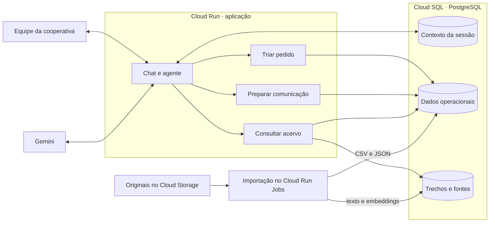

# Arquitetura do agente da Cooperativa Sabor da Terra

A proposta é oferecer à equipe da cooperativa um chat em português para triar pedidos, consultar o acervo e preparar mensagens aos produtores. Um único agente acompanha a conversa no Cloud Run. Assim, depois de analisar um pedido, a equipe pode perguntar “qual desses produtores tem certificação vigente?” sem repetir os produtos ou os nomes sugeridos.

O cenário prevê de 60 a 100 pedidos por dia. Para o protótipo, as três ferramentas podem compartilhar uma aplicação e um banco. O Gemini interpreta o texto e redige respostas. As ferramentas da aplicação consultam registros, verificam datas e calculam valores. Isso permite à equipe conferir por que um produtor foi sugerido ou como se chegou ao total de um relatório.

## Desenho da solução no Google Cloud

A cada mensagem, a aplicação recupera a sessão da pessoa autenticada, incluindo o pedido em análise, os campos pendentes e os produtores mencionados. O Gemini solicita uma das ferramentas e propõe seus argumentos. A aplicação valida os argumentos, executa a operação e devolve ao modelo os resultados e suas fontes. O chat apresenta a resposta e salva o contexto para a próxima mensagem. [Como o Gemini solicita ferramentas](https://docs.cloud.google.com/gemini-enterprise-agent-platform/models/tools/function-calling)

## Como os arquivos alimentam o agente

Antes da demonstração, uma rotina de importação lê os originais no Cloud Storage. Os arquivos abaixo são os insumos previstos nas seções 2 a 6 do *Projeto Intermediário — Assistente Inteligente para Gestão de Cooperativa Agrícola*. Eles ainda não estão no repositório. O enunciado descreve uma cooperativa com 180 produtores e uma amostra didática com 18 cadastros e 15 pedidos.

| Entradas previstas | Uso no protótipo |
| --- | --- |
| `produtores.csv`, `pedidos.json`, `sazonalidade.csv` | Relacionar produtos aos produtores, conservar o texto original de cada pedido e consultar a safra no mês da entrega. |
| `financeiro.csv`, `tabela_precos_outubro_2026.csv` | Apurar vendas e pendências a partir das transações de setembro e outubro de 2026. A tabela de outubro fornece preços de referência por produto e modalidade para consultas daquele mês. |
| `lotes.csv` | Localizar a entrega pelo código exato do lote e devolver os dados de origem registrados. |
| `certificacoes/`, `contratos/`, `fichas_tecnicas/` | Recuperar evidências sobre certificação, condições contratuais ou especificações de produtos. |

Cada registro importado mantém o arquivo e uma referência à linha ou ao item de origem. Para os documentos, a rotina separa o texto em trechos e usa um modelo de embeddings do Google Cloud para representar cada trecho por um vetor. Grava no PostgreSQL o vetor, o texto, a versão do arquivo e a página ou seção. A extensão `pgvector` permite buscar trechos por significado no mesmo banco usado para as consultas exatas. Ao substituir um documento, a importação atualiza os trechos pesquisáveis e preserva a referência da versão citada. [Busca vetorial no Cloud SQL](https://docs.cloud.google.com/sql/docs/postgres/ai-overview)

## Três fluxos para a demonstração

Os nomes, lançamentos e documentos dos exemplos a seguir são fictícios. Os resultados esperados servem para verificar o protótipo quando a equipe receber os arquivos.

### 1. Triar um pedido em duas mensagens

| Conversa em 7 de outubro de 2026 | Ação esperada |
| --- | --- |
| Equipe envia “Restaurante Ipê pediu 30 kg de queijo coalho e umas cx de goiaba pra sexta. É urgente.” | Abrir um pedido de compra para o Restaurante Ipê. Classificar como venda a restaurante e marcar a urgência explícita. Registrar 30 kg de queijo coalho e entrega em 09/10, a sexta-feira seguinte ao recebimento. Guardar a goiaba em caixas e perguntar “Quantas caixas de goiaba o restaurante pediu?” |
| Equipe responde “São 4 caixas.” | Completar o item goiaba no mesmo pedido, preservando comprador, queijo, prazo e urgência. Consultar o cadastro e a safra de outubro para sugerir produtores por item. |

A triagem sinaliza produto fora de safra e quantidade acima da capacidade documentada para o período. Um calendário de safra, por si só, não comprova estoque. Se o cadastro só trouxer capacidade em kg e faltar o peso por caixa, a resposta indica “capacidade a confirmar” para as quatro caixas. O pedido fica disponível para decisão da equipe. Uma sugestão de produtor só passa a contar como alocação depois que a equipe a registra.

### 2. Consultar certificação ou rastrear um lote

Diante de “Quem pode fornecer mel orgânico em 07/10/2026?”, a ferramenta identifica no cadastro quem produz mel e recupera os certificados correspondentes. Para sustentar a resposta, verifica titular, produto coberto e vigência na data consultada. A busca por similaridade localiza o trecho para leitura. A decisão de incluir um nome depende da evidência encontrada.

| Evidência ilustrativa | Resultado esperado |
| --- | --- |
| Certificado de Ana cobre mel de 01/01 a 31/12/2026 (`certificacoes/ana.pdf`, p. 2). | Listar Ana entre os produtores com certificação vigente para mel e citar a página. A disponibilidade para entrega ainda depende da triagem. |
| O último certificado localizado para Beto cobre mel até 30/09/2026 (`certificacoes/beto.pdf`, seção “Validade”). | Informar que a vigência em 07/10 não pôde ser comprovada para Beto, indicando a data e a seção do documento encontrado. |

Para “De onde veio o queijo do lote 2024-089?”, a ferramenta consulta `lotes.csv` por igualdade do identificador. A resposta cita o arquivo e o código do registro antes de acrescentar qualquer evidência documental associada. Se o código estiver ausente ou faltar a origem, a resposta aponta exatamente qual informação não foi localizada.

### 3. Preparar um resumo ou aviso para o produtor

Ao receber “Prepare o resumo de outubro de Ana”, a ferramenta identifica a produtora e o período na sessão. Consultas SQL apuram vendas por data de venda, valores pagos ou pendentes até o fechamento e pedidos com alocação registrada. Cada venda entra uma vez no total, mesmo quando há vários pagamentos. Se os dados não permitirem apurar um indicador, a mensagem identifica a lacuna.

| Lançamento ilustrativo | Venda | Recebido até 31/10 | Em aberto em 31/10 |
| --- | ---: | ---: | ---: |
| Ana, venda de 02/10/2026 | R$ 120,00 | R$ 120,00 | R$ 0,00 |
| Ana, venda de 15/10/2026 | R$ 80,00 | R$ 0,00 | R$ 80,00 |
| **Total de Ana em outubro** | **R$ 200,00** | **R$ 120,00** | **R$ 80,00** |

Com esses lançamentos e uma alocação confirmada no mês, o texto pronto para encaminhar seria “Ana, suas vendas de outubro somaram R$ 200,00. Até 31/10, você recebeu R$ 120,00 e tinha R$ 80,00 a receber. A cooperativa alocou um pedido para você no mês.” A equipe pode conferir as duas vendas no histórico e a alocação no registro do pedido.

Para avisar sobre um pedido novo, a mesma ferramenta usa o produto, a quantidade, o prazo e o estado da alocação. Se a equipe ainda estiver consultando disponibilidade, o texto pode ser “Ana, recebemos um pedido de quatro caixas de goiaba para 09/10. Você tem essa quantidade disponível?”. Em ambos os casos, a equipe recebe o texto no chat para encaminhar ao produtor.
